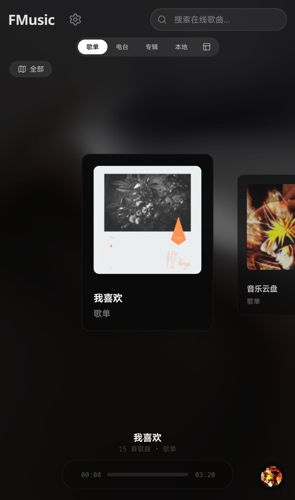
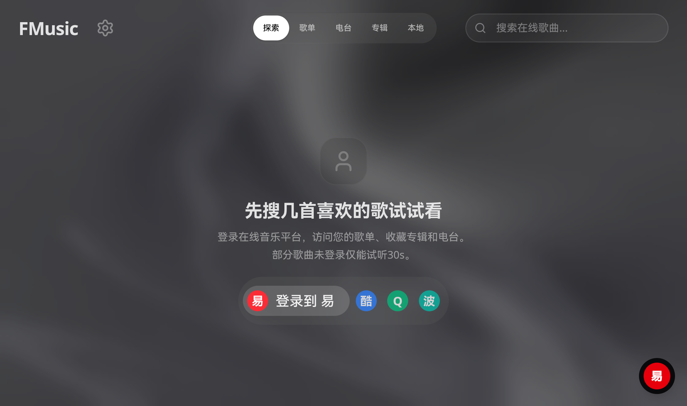

<div align="center">
  
  <h1>HO-FMusic-Folia</h1>
  <p>FMusic · HarmonyOS — 在鸿蒙设备上，享受音乐与沉浸式歌词。</p>
  <p>
    <a href="https://github.com/abc123-hubish/HO-FMusic-Folia/releases/latest">下载最新版本</a> ·
    <a href="CHANGELOG.md">更新记录</a> ·
    <a href="https://github.com/abc123-hubish/HO-FMusic-Folia/issues">问题反馈</a>
  </p>
</div>

FMusic 是基于 [Folia](https://github.com/chthollyphile/folia-major) 适配的非官方 HarmonyOS 音乐播放器，将音乐资料库、全屏歌词动画与鸿蒙系统能力结合，支持本地音乐和多平台音乐服务。

本仓库用于应用介绍、版本说明和安装包发布，仅维护公开文档、图标与许可说明。安装包请前往 **[Releases](https://github.com/abc123-hubish/HO-FMusic-Folia/releases)** 下载。

## 功能亮点

- **沉浸式歌词**：包含全新「花火」在内的多种全屏歌词动画、逐字歌词与动态背景，花火支持画质和视觉效果调节。
- **本地音乐**：通过系统文件选择器导入音频，支持同名歌词与封面，导入内容可在重启后继续读取。
- **多平台服务**：提供网易云音乐、QQ 音乐、酷狗音乐、波点音乐等入口，支持搜索、歌单和账号登录；具体能力取决于平台及服务配置。
- **个性化外观**：主题、封面配色与 AI 主题，支持配置自己的兼容 AI 服务。
- **鸿蒙系统集成**：系统媒体会话、播放控制、后台音频播放，以及文件与图片等内容的导出。
- **多种屏幕布局**：支持横竖屏切换，提供手机、平板与鸿蒙 PC 的界面适配。

## 应用预览

以下为项目开发期间保存的运行截图，界面会随版本、主题与设备变化。点击图片可查看原图。

<table>
  <tr>
    <th width="36%">手机竖屏资料库</th>
    <th width="64%">全屏歌词与在线服务</th>
  </tr>
  <tr>
    <td align="center" valign="middle">
      <a href="assets/screenshots/library-portrait.jpg"></a>
    </td>
    <td align="center">
      <a href="assets/screenshots/lyrics-landscape.png"></a>
      <p>沉浸式歌词播放</p>
      <a href="assets/screenshots/online-services.png"></a>
      <p>在线音乐服务入口</p>
    </td>
  </tr>
</table>

## 下载与安装

当前发布版本：**1.2.3**。本次更新新增花火歌词动画、鸿蒙应用接续和 QQ 试听片段支持，并修复试听歌词同步与 Bravais 首页搜索，详见 [更新记录](CHANGELOG.md)。

| 项目 | 说明 |
| --- | --- |
| 系统要求 | HarmonyOS 6.1.0（API 23）及以上，以设备实际兼容情况为准 |
| HAP 安装包 | `FMusic-HarmonyOS-1.2.3-signed.hap`，用于设备安装 |
| APP 发布包 | 下载 `FMusic-HarmonyOS-1.2.3-APP.zip`，解压获得 `FMusic-HarmonyOS-1.2.3-signed.app` |
| 包名 | `com.bogdan.folia` |
| 签名 | Release 签名 |
| 文件校验 | Release 附带 `SHA256SUMS.txt`，校验 HAP 与 APP ZIP；ZIP 内另附原始 APP 的校验文件 |

1. 打开 [最新版本](https://github.com/abc123-hubish/HO-FMusic-Folia/releases/latest)，下载 Assets 中的 `.hap` 文件。
2. 使用设备支持的 HAP 安装方式安装。已配置开发工具并连接设备时，可执行：

   ```sh
   hdc install -r FMusic-HarmonyOS-1.2.3-signed.hap
   ```

3. 启动 FMusic，导入本地音乐，或按需配置并登录在线音乐服务。

如果设备提示签名或安装权限错误，请在 [Issues](https://github.com/abc123-hubish/HO-FMusic-Folia/issues) 中提供完整提示、设备型号和系统版本。

GitHub 自动生成的 **Source code (zip / tar.gz)** 仅为本发布仓库的文档快照。安装应用请下载 `.hap` 附件。

需要 `.app` 格式时，请下载同一 Release 中的 `FMusic-HarmonyOS-1.2.3-APP.zip`。GitHub 不接受直接上传 `.app` 扩展名的附件，因此以 ZIP 封装，解压后的 APP 与原始签名发布包逐字节一致；ZIP 内附 `APP-SHA256SUMS.txt`。APP 用于需要发布归档的分发或上架流程，不使用上面的 HAP 安装命令直接安装。

## 使用说明

- **导入音乐**：在资料库的本地音乐入口选择音频文件，可同时导入同名歌词和封面。
- **服务连接**：在「设置 → 集成 → 鸿蒙服务连接」中查看或修改在线服务配置；本地音乐无需服务端。
- **横竖屏**：在「设置 → 通用 → 开启竖屏」中切换，选择会在重启后保留。
- **屏幕常亮**：在「设置 → 通用 → 屏幕设置」中开启「屏幕不熄屏」，仅在应用前台显示时生效。
- **AI 主题**：按需配置自己的 AI 服务地址、模型与密钥；使用前请了解所选服务的调用费用。
- **应用接续**：双端安装支持接续的版本、登录同一华为账号并开启系统「多设备协同 → 接续」后，可通过系统接续入口迁移播放状态；本地音频需提前导入目标设备，实际双设备体验尚待实机验证。
- **QQ 试听**：仅播放平台实际提供的试听片段，并显示试听提示；歌词会按片段起点同步，试听能力不改变完整歌曲的播放权限。
- **平台权限**：在线音乐的播放、账号权限与地区限制由对应平台决定，登录不会改变平台原有权限。

本项目持续进行鸿蒙适配；原项目中依赖 Electron、桌面插件、FFmpeg 或桌面模型的功能不保证全部可用。各设备上的界面和后台播放效果以实际使用为准。

## 问题反馈

请通过 [Issues](https://github.com/abc123-hubish/HO-FMusic-Folia/issues) 提交问题，并尽量包含：

- 应用版本、设备型号、HarmonyOS 版本。
- 复现步骤、预期结果和实际结果。
- 必要的截图或错误提示；提交前请移除账号凭据、Cookie、密钥等个人信息。

## 致谢与许可证

感谢 [chthollyphile/folia-major](https://github.com/chthollyphile/folia-major) 及其贡献者。本应用的基础 Web 项目版本为 **0.7.17**；本项目与上游及各音乐平台不存在官方隶属关系。

Folia 及本项目现有代码采用 **AGPL-3.0**，完整许可原文见 [LICENSE](LICENSE)。本仓库用于发布文档和安装包，不改变应用及第三方组件原有的许可证要求。

第三方组件说明与许可原文见 [THIRD-PARTY-NOTICES.md](THIRD-PARTY-NOTICES.md) 和 [licenses](licenses)。在线音乐、歌词、封面等内容的权利归各自权利人所有。
